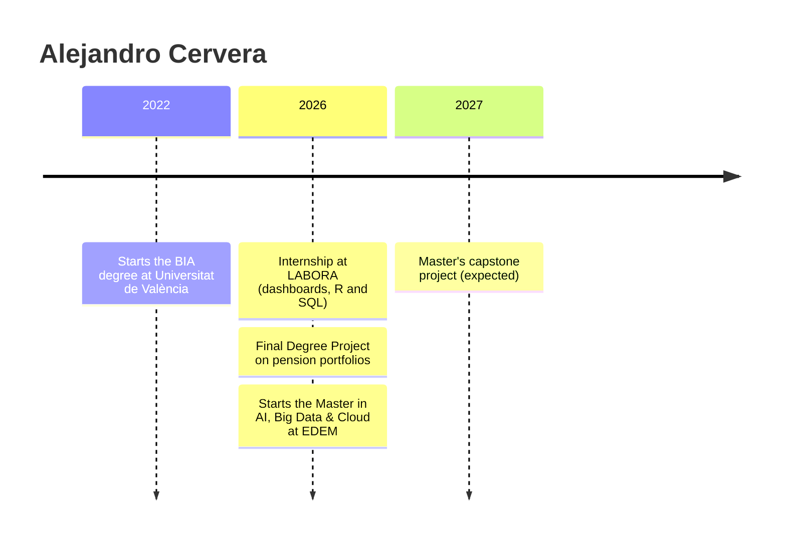

 

---

## 👋 About me

Business Intelligence and Analytics graduate (**Universitat de València**) with hands-on experience in **R** and **SQL**, applied to public labour market data and to quantitative finance. Currently completing a Master's in **AI, Big Data & Cloud** at EDEM, working on data and machine learning solutions on Google Cloud.

🎯 **Looking for:** data analyst roles where I can turn complex datasets into reliable dashboards and decision-ready insights.
🌐 **Languages:** Spanish & Valencian (native) · English (B2, Cambridge First)

---

## 🧰 Tech stack

**Day to day**

**Methods:** statistical modelling · Monte Carlo simulation · bootstrap resampling · financial analysis

**Currently learning** *(Master's at EDEM)*

---

## 💼 Experience

<b>Data Analyst Intern · LABORA</b> (Valencian Employment and Training Service) · <i>01/2026 – 05/2026</i>

 

Modernisation and Analysis Department.

- 📈 Designed and built a **dashboard** tracking monthly unemployment data for the Valencian Community, enabling press officers and institutional representatives to access labour market insights without direct access to the underlying data.
- ⚡ **Optimised database loading and processing** in R and SQL, reducing processing time and improving code quality.
- 🗄️ Maintained and improved the quality and structure of labour market databases.

---

## 🎓 Education

<b>Master in Artificial Intelligence, Big Data & Cloud</b> · EDEM Escuela de Empresarios · <i>09/2026 – 07/2027 (expected)</i>

 

Hands-on programme on Google Cloud covering MLOps and generative AI, with a capstone project for a partner company.

<b>Bachelor's Degree in Business Intelligence & Analytics</b> · Universitat de València · <i>2022 – 2026</i>

 

Coursework in statistical modelling, operations research, financial planning and digital commerce.

---

## 📊 Featured project

<b>Pension portfolio allocation: classical 60/40 vs. 50/20/30</b> · <i>Final Degree Project (10/10)</i>

 

Comparison of a classical **60/40** portfolio with a **50/20/30** allocation for pension planning, based on **20 years of daily market data** (2006-2026).

| | |
|---|---|
| **Analysis** | Historical, Monte Carlo and bootstrap analysis |
| **Robustness** | Sub-period analysis and multiple shortfall thresholds |
| **Metrics** | CAGR · Sharpe and Sortino ratios · maximum drawdown · shortfall probability |
| **Stack** |  |

<!-- TODO: add the repository link here once the code is published -->

---

## 🗺️ Path

---

## 📈 GitHub stats

---

*Open to opportunities in data analytics. Let's talk!*

